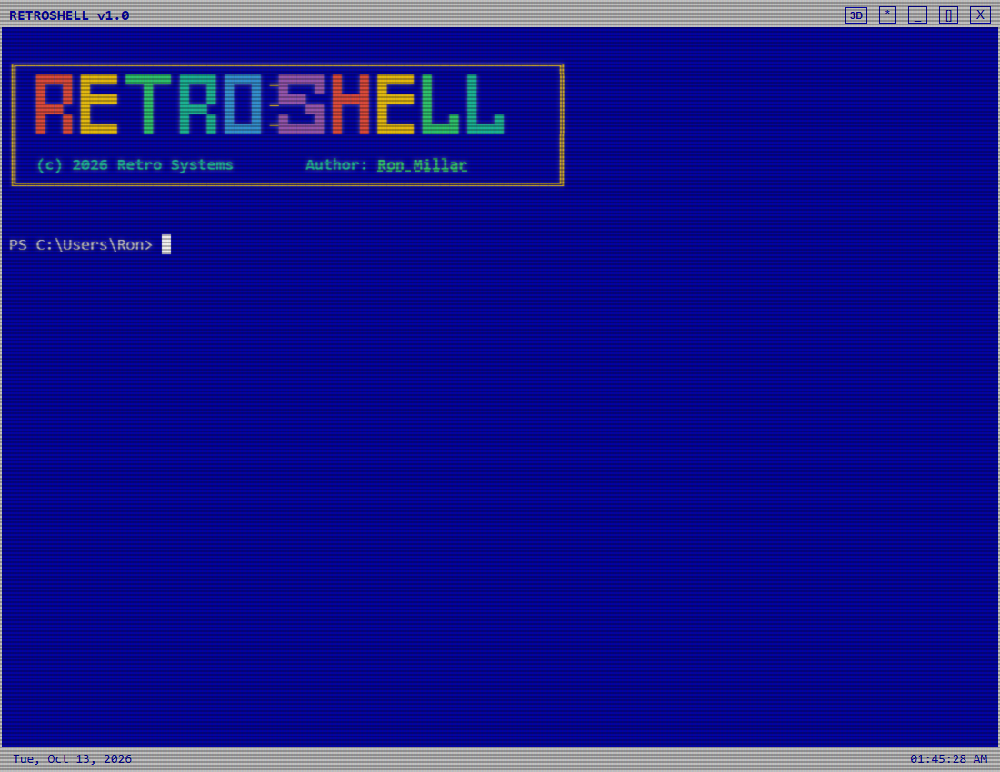
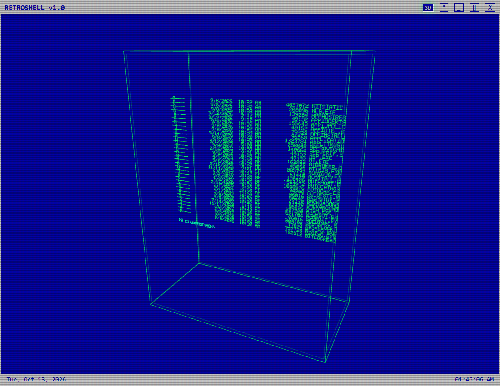
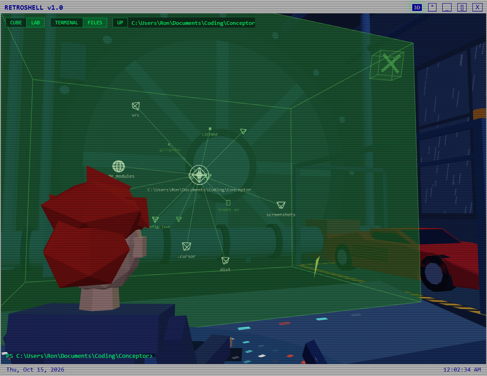

# RetroShell

A retro-styled PowerShell terminal for Windows, with CRT effects, keyboard sounds and a 3D holographic mode.







## Features

- **A real terminal** - a full PowerShell session running through xterm.js and node-pty.
- **Four themes** - Holographic, DOS Blue, Amber and Green Phosphor.
- **CRT look** - scanlines, flicker and phosphor glow.
- **Sound effects** - synthesized key clicks, spacebar, return and bell sounds. Can be switched off.
- **3D mode** - the live terminal rendered as voxel text inside a rotating wireframe cube. You can keep typing while it is on.
- **The lab** - in 3D mode, LAB puts your terminal (or the file graph) on the scientist's translucent green display from the lab in *Another World* (*Out of This World* in the US), seen over his shoulder, after a short identification and boot sequence. Drawn in the game's flat-polygon style, with a storm outside the window, a soda machine, and his red car rising on a lift as the lab boots; drag to swing the camera around it. The display boots to three floating cubes: the accelerator experiment, your terminal or file graph, and the game itself. The scientist types when you type and works his mouse when you use yours.
- **File graph** - in 3D mode, switch from CUBE to FILES and the cube bursts open into a floating graph of the shell's current folder. Folders open and close as you click them, files are drawn as a different wireframe shape per kind, and clicking a file puts its path on the command line.

## Controls

| Action | How |
| --- | --- |
| Toggle 3D mode | `Ctrl+3` or the `3D` button |
| Open settings (theme, sound) | `Ctrl+,` or the `*` button |
| Rotate the cube | Drag with the mouse |
| Reset the cube | Double-click it |
| Choose the setting | `CUBE` / `LAB` in the corner of the 3D view |
| Choose what it shows | `TERMINAL` / `FILES` beside it; keep typing, the terminal stays live |
| Open a program in the lab | Click one of the three cubes on the display (hover to see which is which); typing opens the terminal |
| Close it | Click the small X cube in the display's top right corner |
| Look around the lab | Drag to swing the camera, scroll to move closer, double-click empty space to go back to the shot over the shoulder |
| Resize the window | Drag any edge or corner |
| Move the window | Drag the title bar |

### File graph

| Action | How |
| --- | --- |
| Show the file graph | `FILES` in the corner of the 3D view (works in the open and in the lab) |
| Open or close a folder | Click it |
| Make a folder the centre of the graph | Right-click or double-click it |
| Go up a folder | `UP`, or double-click the ringed root at the centre |
| Put a file's path on the command line | Click the file |
| Show a file's details | Double-click the file |
| See a node's full name | Hover over it |
| Rotate / zoom | Drag / scroll |

The graph starts at the shell's current folder and follows it when you `cd`. The file details panel can also re-centre the graph on the file's folder or show the file in Windows Explorer. Labels are hidden where they would overlap; zoom in or hover to see more.

Folders change shape with how much is directly inside them, and hovering one shows the exact count. The root has a ring around it.

| Folder shape | Items inside |
| --- | --- |
| Pyramid | Under 10 |
| Diamond | 10 - 49 |
| 20-sided | 50 - 199 |
| Sphere | 200 or more |

Files are smaller and drawn in the text color rather than the folder color:

| File shape | Kind of file |
| --- | --- |
| Cube | Code |
| Pyramid | Data / config |
| Upright page | Document |
| Picture frame | Image |
| Record | Audio |
| Play triangle | Video |
| Box in a box | Archive |
| Faceted gem | Program / script |
| Mesh sphere | 3D model |
| Dot | Anything else |

## Playing Out of This World in the lab

The right-hand cube on the lab's display plays the original DOS game, in colour, on the scientist's display. It runs in DOSBox via [js-dos](https://js-dos.com/). The game itself is not included with RetroShell; you supply your own copy.

1. Download the DOS version from [DOS Games Archive: Out of This World (Another World)](https://dosgames.com/game/out-of-this-world-another-world/). It comes as a `.zip` of the game's DOS files. Leave it zipped.
2. In RetroShell, open 3D mode (`Ctrl+3`), choose `LAB`, and click the right-hand cube.
3. The first time, a file picker asks for the zip. RetroShell keeps a copy in its own app data folder (`%APPDATA%
etroshellgames`), so you only pick it once.

While the game is on the display it takes the keyboard: arrow keys to move, `Space` to run and kick, `P` to pause. Click the X cube to pause the game and leave it; click the game cube again to carry on. The game's sound follows RetroShell's sound setting. To use a different copy of the game, delete `out-of-this-world.zip` from that folder and pick again.

## Running from source

You need [Node.js](https://nodejs.org/) on Windows. `node-pty` is a native module that gets rebuilt for Electron during install, which needs the Visual Studio C++ build tools.

```bash
npm install
npm start
```

## Building an installer

```bash
npm run dist:win
```

This writes an NSIS installer and a portable `.exe` to `release/`. The packaged app asks for administrator rights when it starts.

## Built with

[Electron](https://www.electronjs.org/), [xterm.js](https://xtermjs.org/), [node-pty](https://github.com/microsoft/node-pty), [three.js](https://threejs.org/) and [js-dos](https://js-dos.com/).

## License

[MIT](LICENSE) © 2026 Ron Millar

The lab's game cube uses js-dos's `emulators` package (DOSBox), which is licensed under GPL-2.0. *Out of This World* / *Another World* is © Éric Chahi and is not part of this repository.
